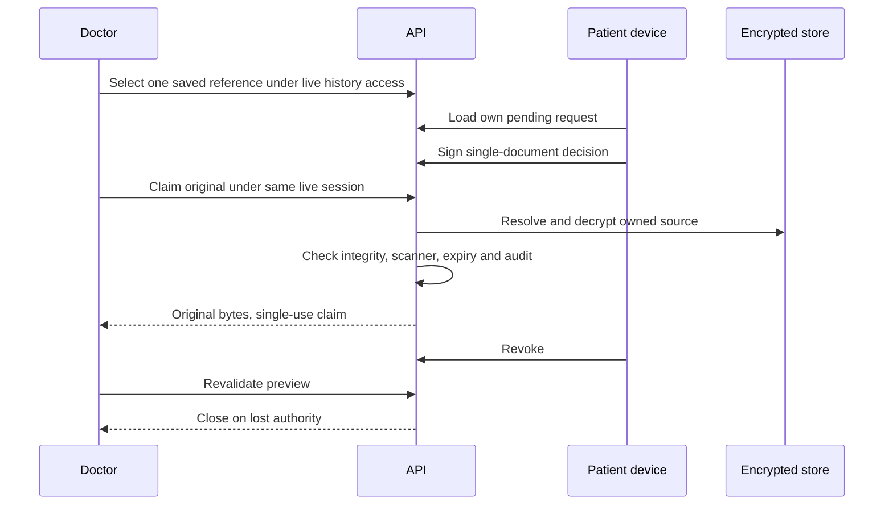

# Original document access V1 — design and qualification

## Decision before implementation, 20 November 2026

P1A discloses metadata. A V3 signed history grant and the Treatment Session V1 operation set each omit the identity of the original. Neither can establish an informed decision about a particular file. Use the existing authenticated clinician and patient sessions, current eligibility and facility, V3 live Redis/PostgreSQL validation, native enrolled P-256 key, patient-scoped storage adapter, erasure registry, source safety scanner, and audit outbox. Add a separate document decision and claim. A history bearer alone must never release bytes. Identity-review, emergency, clinical writes and extraction permissions are outside the new contract.

## Threats and controls

Treat lookup IDs, URLs, request bodies, browsers and imported bytes as untrusted. Select patient from the validated grant, reject contradictory selectors and join document, completed self-import and retained source on owner and immutable identifiers. Bind the signed decision to protocol, exact document and content digest, patient, provider, hospital, initiating session, original history session, purpose, nonce, time limit and enrolled key. Persist the decision and serialize claim/revoke on the same row. Revalidate live authority after expensive source checks. Expiry, erasure, absent source, revoked keys, dependency failure and failed durable auditing close access. Use minimum-necessary display metadata. Patient review makes no claim about the report issuer or clinical verification.

A lost response after claim requires a new patient approval. Revocation closes application preview on the next successful notification or status check; a disconnected client must fail closed within a bounded lease. Information already seen or copied cannot be recalled. Reviewers must qualify the signed display, document parser/browser boundary, concurrent revocation, retention and physical signing. Only synthetic local development is in scope.

Affected controls: SEC-001/002/003/005/011/013/014/015/020/023; purpose limitation, clinical consent, minimization, audit and erasure under the repository India baseline. Patient data access, signing, audit and a lifecycle record are affected. No clinical interpretation, emergency expansion or change of cloud infrastructure. Validate focused contracts, broker/database failures, frontend lifecycle and full CI. Independent clinical, privacy and security review remains outstanding.

## Rehearsal on disposable services

1. Use the repository's local development setup with loopback PostgreSQL, Redis, local encrypted document storage and an actual configured ClamAV daemon. Apply the single Alembic head `20261120_document_access` on the disposable database. This migration is forward-only. It stores one bounded decision and a signature, with separate event history in the existing outbox. The erasure path removes linkable decision material. An older application can leave the additive table unused.
2. Select [the bundled synthetic Hospital X report](../demo/synthetic-hospital-x-report.pdf) and the explicit development-only demo extraction provider. The adapter recognizes these exact bytes and reads the printed laboratory line from its PDF text layer. The review screen uses that source text and page. This supports this one rehearsal layout. Other files require a separately configured extractor that produces reviewable evidence. The issuing institution appears inside the report; the import has no independently verified source-institution field.
3. On the patient app, import the report, review the evidence and explicitly save it. Enrol a real patient device using the existing enrollment flow before the live rehearsal.
4. Sign into the doctor web app with an eligible clinician at the receiving facility. Discover the synthetic patient, obtain their signed routine history consent and open Documents. Select the saved reference and request the original.
5. On the enrolled patient device open Treatment Access, refresh document requests, inspect the provider, receiving facility, exact document, purpose and deadline, then allow or deny. The clinician can open the approved original once. A denied or expired request requires a new patient decision.
6. Revoke while the preview is visible. Check disappearance within the eight-second client lease in the active browser, terminal status, denial of subsequent openings and the single `ORIGINAL_DOCUMENT_OPENED` event. Test the same flow with a fresh, approved but unopened request revoked before claim. Record hardware/OS, SHA and timestamps using synthetic identifiers only.

### Repeatable backend qualification

With the test dependencies and disposable loopback URLs from the CI workflow, run `python -m scripts.ci.prepare_ci_shared_db`, then `python -m pytest tests/integration/test_original_document_access.py -q`. The shared qualification database and Redis namespace are disposable. This fixture performs HTTP requests against the ASGI application, real provider login, database and Redis checks, software P-256 signing and encrypted storage. It reads the actual PDF text through the development demo adapter and, by default, supplies a scanner double. It exercises text extraction on one known synthetic fixture; it does not qualify general OCR. For a live INSTREAM scan, set `P1B_REHEARSAL_CLAMD=1`, `PATIENT_SOURCE_MALWARE_SCANNER=clamd` and the loopback scanner host/port before running. Use the operational scanner readiness check with current official definitions for an investor rehearsal.

Run `python -m pytest tests/test_original_document_contract.py tests/test_provider_document_inventory.py` for contract tests. From nexa-client run `yarn test` and `yarn verify:next-build`. The in-app PDF viewer renders pages locally as pixels without interactive PDF annotations, attachments or remote viewers. Rendering support remains subject to real browser and device qualification.

### Review and release decision

The original is patient-controlled. The issuing institution and clinical findings remain unverified by Nexa Care. Security, privacy and clinical reviewers must independently inspect the signature display, audit visibility, concurrency and erasure. Complete a physical-device signed rehearsal with official scanner definitions before marking INVESTOR_DEMO_READY. DO NOT MERGE WITHOUT EXPLICIT PROJECT OWNER AUTHORIZATION.

## Qualification record

The real-service rehearsal exercised a patient upload, PDF text extraction on the bundled fixture, explicit patient review and save, signed routine history, separate per-document approval and byte-for-byte retrieval. Two simultaneous claims produced one successful release. Revocation was also tested before first opening. An unavailable outbox, unavailable storage and scanner denial each prevented release. The test used disposable PostgreSQL and Redis, local AES-GCM storage, a real loopback ClamAV daemon with a synthetic control signature database, and a software signing key. These observations qualify the software path. Current official scanner definitions, a physical enrolled device, a physical NFC tap and a clinician observing the original in a real browser require a separate rehearsal.

The frontend component suite covers revocation and release of object URLs, delayed retrieval after unmount, and existing patient consent controls. The production web build includes the PDF.js worker as a local asset. Local Chromium could not open its process socket. No visual browser rehearsal or physical-device signature is attributed to the automated tests.

Second self-review added exact affiliation binding, live parent validation at approval, bounded encrypted-object reads, dedicated audit events for authority checks and coverage of erasure when source rows are already gone. Independent clinical, privacy and security review is still open.
