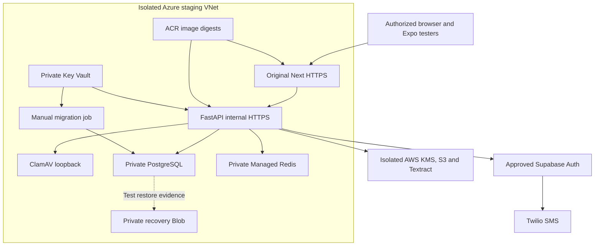

# Nexa Care Azure staging architecture

Decision date 24 November 2026 · Candidate for isolated synthetic staging · Live qualification pending

## Change record

Use the staging source at `f1177755251a060964a4e6f734028739eef9311a` as the base. Integrate the signed-original and genuine clinician workflows from `12d2a0c868958d6bab6ce7dff8ff0a1b8f44ca3f` on the dedicated migration branch. This is code integration for staged testing. The approved deployment revision must have its own successful CI, database head, browser/device evidence and independent reviews. The original patient and provider entry screens must match the selected main baseline, `6f9959d8ad48804c3bfdac3501fb480f7e2f7708`. [Repository agent contract](../../AGENTS.md) · [Staging fidelity policy](../governance/PATIENT_WORKFLOW_NON_REGRESSION_20261124.md)

SEC-001–004, 006–008, 011–020, 022–024 and the signed-original and identity-disclosure policies apply to consent, identity, audit, key custody, scanner behavior and readiness. REG-001–005, 009, 014, 017–020 govern the privacy and operational review. The engineering constitution requires original product fidelity, a separate migration task, value-free telemetry, independent reviews and real evidence for physical or cloud results. This change prepares isolated infrastructure and integrates existing drafts for synthetic testing. No production or historical patient data, live consent, identity records, model outputs, erasure state or emergency paths are changed by the infrastructure work. [Security register](../governance/SECURITY_NON_REGRESSION.md) · [India baseline](../governance/INDIA_REGULATORY_BASELINE.md) · [Identity evidence](../governance/IDENTITY_EVIDENCE_DISCLOSURE_POLICY.md) · [Engineering constitution](../governance/NEXA_CARE_ENGINEERING_CONSTITUTION.md)

## Source checks and release state

| Source checked | Verified state at 24 November 2026 |
| --- | --- |
| [Main at `6f9959d8`](https://github.com/sohamsadegaonkar/Nexa_Care/tree/6f9959d8ad48804c3bfdac3501fb480f7e2f7708) and [PR #100](https://github.com/sohamsadegaonkar/Nexa_Care/pull/100) | #100 merged. Azure Blob, Key Vault wrapping and Document Intelligence code is intentionally opt-in for synthetic development. |
| [PR #99](https://github.com/sohamsadegaonkar/Nexa_Care/pull/99) at `25ac75f0` | Draft. Exact-head backend, frontend, Azure offline, ClamAV and signed-original scanner checks passed. Physical signing, live Azure and reviewers remain open. |
| [PR #101](https://github.com/sohamsadegaonkar/Nexa_Care/pull/101) at `12d2a0c8` | Draft. Seven exact-head workflows passed, including actual Chromium/Next/FastAPI doctor login, MFA and no-consent denial on disposable services. Authorized source opening on Azure, physical signing and NFC remain unverified. |
| [PR #106](https://github.com/sohamsadegaonkar/Nexa_Care/pull/106) at `f117775` | Draft. Six exact-head workflows succeeded. [Deployed staging readiness failed](https://github.com/sohamsadegaonkar/Nexa_Care/actions/runs/45333936370). Render web is a preview. Its FastAPI staging image built and its startup was refused because the proxy and real service contracts were unresolved. |
| [Development Azure renderer](../../scripts/render_azure_demo_plan.py) | Offline development candidate for pre-existing resources. Its demo extraction and development-only provider switches are excluded from hosted staging. |

## Source-verified system

| Boundary | Current implementation | Staging disposition |
| --- | --- | --- |
| API | `app/main.py` mounts legacy API and v2 auth, registrations and recovery, roles, MFA, device/NFC, push, patient self/profile/discovery/records/import, policy, routine and v3 consent/history, emergency, treatment, document pipeline/review/identity review, provider workspace/trust/documents, FHIR, dashboard and contract routers. #101 adds signed original-document request, approval, availability and byte access. Route dependencies, including current clinician eligibility, are authoritative. | Build the real FastAPI image. Verify the [registered route inventory](AZURE_STAGING_ROUTE_INVENTORY.md) and production-like feature flags against the selected release revision. |
| Clients | `nexa-client/apps/next` is the original Next.js product with a same-origin API rewrite. The browser production bundle requires its exact HTTPS origin at build time. Expo in `nexa-client/apps/expo` shares `packages/app`; device signing, biometrics, push and NFC have native dependencies. | Build the original web workspace and distribute a staging-only mobile build with the approved HTTPS API origin. Repeat signed device and browser cases. |
| Postgres | SQLAlchemy/asyncpg and Alembic. The vault and clinical shard are separate data models; tables also hold provider trust/session data, DEK metadata, consent and policy, document/extraction lineage, audit chain heads/outbox and treatment state. Main head is `20260919_medication_catalog`; #101 adds `20261120_document_access`. | Fresh private PostgreSQL 16. Separate admin, migrator and least-privilege runtime. Validate the exact head before starting FastAPI. Inspect the applied schemas and privileges on the isolated server. |
| Redis and workers | `app/core/redis.py` uses redis-py with `UPSTASH_REDIS_URL`; the variable can point to any compatible TLS service. Consent capabilities/challenges, replay protection/rate limits and session/MFA state depend on Redis semantics. API lifespan supervises audit-outbox, quarantine and optional provider reconciliation workers. Celery/Flower dependencies alone do not establish a required worker deployment. | Use private Managed Redis with the nonclustered command model and no eviction. Re-test Lua, atomic consumption, TTLs, session/revocation, failover and multi-replica workers before scaling. Treat Redis as ephemeral security state during recovery. |
| Identity | Patient OTP routes use Supabase Auth; Twilio sits behind the phone provider. Nexa resolves the verified patient identity in its Postgres and applies its own session/signing logic. #106 bounds staging send and verify to authorized test phones. Provider password and TOTP MFA use separate Nexa account, trust and session checks. | Evaluate existing `alpha_testing` as authentication only, subject to isolation, operator approval and proof of authorized synthetic accounts. Keep the allowlist server-side, verify signup/OTP controls and do not connect alpha clinical tables. Use a dedicated auth project if shared credential scope or identity isolation cannot be demonstrated. |
| Source storage and crypto | `app/services/document_storage.py` enforces encrypted, ownership-bound sources. Hosted runtime additionally verifies AWS S3 private access, versioning and KMS encryption. `app/services/crypto_kms.py` and DEK persistence bind patients and wrapping material. Medication catalog verifies a separate P-256 signing key. | Retain these interfaces and independently isolated AWS resources for the first hosted stage. Qualify Azure Blob and Key Vault in a separate sandbox, including legacy recoverability, rotation and exact erasure claims, before selecting either in hosted runtime. |
| Document extraction and scanning | `app/ai/extractor.py`, Textract parsing and async provider reconciliation preserve source evidence. Hosted startup allows real Textract or an approved HTTPS remote provider. `app/security/patient_source_malware_scanner.py` requires ClamAV in staging and gates on availability, accepted types and size. | Keep real Textract in the isolated account. Co-locate an immutable ClamAV sidecar bound to loopback. Verify database freshness, bounded scans and fail-closed outage. Benchmark Azure v4 Layout on synthetic documents before any hosted replacement. |
| Clinical access and auditing | SignedApprovalVerifier, consent/capability gates, trust and erasure checks enforce access. Original source requires a separately scoped signed grant. Hash-linked audit partitions and transactional outbox enforce durable, safe evidence. `/healthz` is liveness, `/health` is API dependency readiness and `/ops/health` adds protected diagnostics. | Preserve the application gates. Add aggregate service telemetry, inspect audit continuity on restore, and compare denied/allowed evidence on the exact release. Avoid access logs that contain patient or grant identifiers in paths. |

## Decisions

| ID | Decision and trade-off |
| --- | --- |
| AZ-01 | Use Bicep for Azure control plane and separate foundation, migration job and application steps. Central India is the staging candidate. Public catalog listing supports investigation; subscription-specific SKU, quota and policy readback plus ARM validation remain release gates. |
| AZ-02 | Use the Container Apps consumption workload profile in a dedicated VNet. Next terminates HTTPS on an allowlisted staging ingress and calls the FastAPI internal HTTPS FQDN. Bind ClamAV to the app replica loopback. Use separate managed identities for registry pulls, secrets and workload access. Verify actual forwarded-header hops before enabling test phones. |
| AZ-03 | Use Azure PostgreSQL Flexible Server on a delegated private subnet and Azure Managed Redis through Private Link. Require verified TLS. The existing application supports a scoped Postgres credential and Redis access key; keep both in versioned Key Vault references and verify rotation/failover before production. Reconsider Entra database/cache auth after the app supports token refresh for all sync and async clients. |
| AZ-04 | Use ACR Basic for the synthetic candidate with admin and anonymous access off, scoped `AcrPull`, immutable deployment digests and explicit provenance. Basic has a publicly reachable authenticated data plane. Evaluate Premium with Private Link and restricted build/pull networks for production. |
| AZ-05 | Use Key Vault for staging secret custody, private Blob for synthetic recovery artifacts, and revision-scoped operational health. Keep AWS KMS/S3/Textract for the first hosted stage, using a dedicated short-lived workload role and private clinical storage. Azure adapters from #100/#101 stay in the synthetic development boundary until independent evidence supports an equivalent runtime contract. |
| AZ-06 | Use Azure Monitor through the platform log pipeline with separate access and ingestion caps. Keep information that can identify a patient or reveal a bearer token, source bytes or consent in approved application evidence only. Application Insights with outbound trace correlation and procurement-specific retention is a later decision after value-safe sampling and residency review. |
| AZ-07 | Treat deployment and clinical release as separate decisions. An engineering-stage web health response establishes dependency health only. The gate sheet tracks real workflows, device evidence, backup recovery and required independent sign-offs. |

## Isolation and scale

| Environment | Boundaries | Capacity and controls |
| --- | --- | --- |
| Development | Local disposable Postgres/Redis, separate developer identities and fixtures. Optional isolated Azure adapter sandbox with dedicated subscription/RG, vault, Blob account and managed identity. No public ingress or shared credentials. | Default to local. Allocate metered services only for approved short experiments; remove them after evidence is preserved through a separately approved action. |
| Staging | Dedicated subscription if available, otherwise a dedicated RG, VNet, private DNS links, app registry and identities. No peering to production. Separate DB, Redis, Vault, logs, AWS role/bucket/keys, enrolled devices and synthetic users. Restrict operator and ingress access by role and approved test sources. | One active API during qualification because workers run in-process and scanner capacity is replica-bound. Scale after mixed-operation and worker-concurrency tests. Test managed PITR and independent artifact restore. |
| Production | Future dedicated subscription and management boundary. Private data planes and traffic through an approved WAF/edge, dedicated image delivery, privileged access with review, controlled egress and approved India recovery location. Evidence and backup custody separated from runtime. | Use zone-redundant Postgres and Redis HA where available, multiple application/worker replicas, no-eviction headroom, measured load and restore capacity. Establish approved release and data-processing authorization before provisioning or onboarding. |

## Threat model

| Threat | Control | Evidence required for staging or release |
| --- | --- | --- |
| Cross-patient or cross-hospital exposure | Derive identity and tenant server-side; recheck current clinician eligibility, patient, hospital, scope and source ownership. Private object storage with application encryption. | Normal accounts and synthetic documents across two patients and hospitals; authorized succeeds, unauthorized access denied, identifiers remain absent from telemetry. |
| Consent bypass, stale privilege or replay | Device-bound signing, single-use Redis challenge, separate original grant, scoped capabilities, expiry and revocation. Emergency disclosure stays separate and bounded. | Verify signed grant, revocation, expiry and audit; qualify concurrent use, disabled clinician and offline/disconnect behavior with approved fixtures. |
| Credential and session theft | Managed identities, version-pinned secret references, separate role boundaries, TLS, first-party cookies and canonical MFA binding. | Vault/registry private access and RBAC readback, credential rotation rehearsal, MFA and revoked session checks. |
| OTP abuse | Staging allowlist, Supabase signup control, HMAC-based limits, trustworthy forwarded address and Twilio spend/geo limits. | Authorized device receives one real short-lived code; expired, wrong and replayed codes fail. Unlisted phone denied before any SMS request. Confirm proxy-chain and spending controls. |
| Malicious uploads and unsafe extraction | Size and MIME checks, loopback scanner with validated signatures, real OCR provenance, human review and encrypted storage. | Clean synthetic document succeeds. Approved standard scanner test fixture and scanner-outage tests fail closed. Compare exact text/location provenance, and verify correction/audit. |
| Key compromise or insider | No static AWS key; scoped expiring role; private vault; distinct keys and accounts; separation of deploy, recovery and clinical review. | Exact permissions and denial from adjacent identities, key-version rotation and historic restore. Examine privileged access through provider audit logs. |
| Supply-chain compromise | Base and release images are digest-scoped; verify source revision, provenance, SBOM and scanner database freshness independently before publishing/deploying. | Inspect the exact API, web and scanner digests, vulnerability results, signatures/attestations and build-to-release binding. |
| DB theft, audit tampering and backup loss | Private TLS DB, scoped SQL roles, hash-linked audit and outbox, read/write separation for backups, separate recovery identity and restored-state checks. | Test TLS/hostname and ACL failures, application role cannot change migration ledger, audit verifier succeeds after restore, and backup operators demonstrate recovery without replaying old access state. |

## India review

- The November 2025 DPDP commencement notification staggers provisions across publication, one year and 18 months. Keep a dated applicability matrix, document processor and fiduciary roles, notices, lawful basis, access/correction/erasure, incident response and cross-border position with counsel. Clinical access consent and DPDP processing authority remain distinct. [Official commencement notification](https://www.meity.gov.in/static/uploads/2025/11/c56ceae6c383460ca69577428d36828b.pdf) · [Repository legal register](../governance/INDIA_REGULATORY_BASELINE.md)
- Apply ABDM policy and technical requirements when the relevant exchange role and agreement are established. Preserve provenance, consent evidence and revocation now. Verify providers, regions, subprocessors and all telemetry/backup flows before any real-patient release. India-only custody is the proposed production architecture constraint, subject to signed legal and contractual review. [National Health Authority policy](https://abdm.gov.in/) · [Repository ABDM baseline](../governance/INDIA_REGULATORY_BASELINE.md)
- CERT-In directions include six-hour reporting for specified reportable cyber incidents and a 180-day log requirement within India for covered entities. Review entity applicability, time sync, minimum safe log fields, retention and reporting ownership with counsel. Staging's engineering telemetry defaults do not establish regulated production retention. [CERT-In directions and FAQ](https://www.cert-in.org.in/)

## Operational artifacts

- [Deployment, migration, rollback and recovery](AZURE_STAGING_DEPLOYMENT.md)
- [Central India cost and scale assumptions](AZURE_STAGING_COST_MODEL.md)
- [Qualification register](AZURE_STAGING_QUALIFICATION.md)

## Azure source references

- [Container Apps network design](https://learn.microsoft.com/azure/container-apps/networking) · [App-to-app HTTPS](https://learn.microsoft.com/azure/container-apps/connect-apps) · [Ingress headers](https://learn.microsoft.com/azure/container-apps/ingress-overview) · [Key Vault references](https://learn.microsoft.com/azure/container-apps/manage-secrets)
- [PostgreSQL network concepts](https://learn.microsoft.com/azure/postgresql/flexible-server/concepts-networking-private) · [TLS and CA rotation](https://learn.microsoft.com/azure/postgresql/flexible-server/security-tls) · [Managed Redis private link](https://learn.microsoft.com/azure/redis/private-link)
- [ACR tiers](https://learn.microsoft.com/azure/container-registry/container-registry-skus) · [Document Intelligence privacy](https://learn.microsoft.com/azure/ai-services/document-intelligence/faq) · [Products by region](https://azure.microsoft.com/explore/global-infrastructure/products-by-region/) · [Pricing meters](https://prices.azure.com/api/retail/prices)
